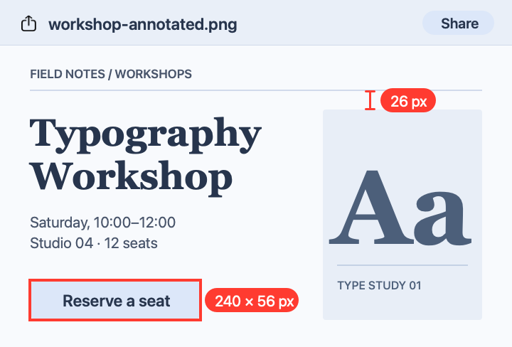

  
  <h1>PixelsMeasure</h1>
  
Measure sizes, spacing, and alignment on Mac, iPhone, and iPad.

[][app-store]

**Requires macOS 14, iOS 17, or iPadOS 17 or later.** Free to download, with optional Pro purchases.

The [App Store][app-store] currently offers **4.6.0**. The document workflow and Free and Pro comparison below describe **PixelsMeasure 5.0**, the upcoming release.

## What's new in 5.0

On Mac, measure your screen with **Live Measure** from the menu bar. Use Probe to read gaps between edges and Cross to check alignment and pointer coordinates. Pin the measurements you want to keep, then choose **Open as Document** to continue editing them with the captured image. Live Measure requires macOS Screen Recording permission; measuring an image does not.

On Mac, iPhone, and iPad:

1. **Open a screenshot, photo, or mockup.** Zoom in to see the pixel grid and adjust edge detection tolerance when shadows or low contrast make edges hard to pick out.
2. **Pin and edit measurements.** Organize pins in layers and use the inspector to adjust their position and size.
3. **Save or share your work.** Keep the original image and measurements in an editable `.pixelsmeasure` document, export an annotated PNG, or copy measurement values as CSS, JSON, or plain text. Save the document in iCloud Drive to reopen it on your other devices.

## Free and Pro in 5.0

| Free | Pro |
| --- | --- |
| Pin up to 3 measurements per document or live session | Pin unlimited measurements |
| Keep using Probe and Cross after reaching the pin limit | Measure objects and areas, and snap guides to edges |
| Save and share editable documents and export annotated PNGs | Copy multiple measurements at once, crop, and rotate images |

Try the Pro tools in the sample document included in the app.

## Website and support

This repository hosts the [PixelsMeasure website](https://pixelsmeasure.com/), support resources, and issue tracker. See the [website README](website/README.md) for local setup.

For bugs or feature requests, search [existing issues][issues] or [open a new issue][new-issue]. For private support, email [pixelsmeasure@gmail.com](mailto:pixelsmeasure@gmail.com).

PixelsMeasure processes images and measurements on your device. See the [Privacy Policy](Privacy.md) and [Terms of Service](tos.md) for details.

[app-store]: https://apps.apple.com/app/pixelsmeasure/id1638740542
[issues]: https://github.com/zddhub/PixelsMeasure/issues
[new-issue]: https://github.com/zddhub/PixelsMeasure/issues/new/choose
